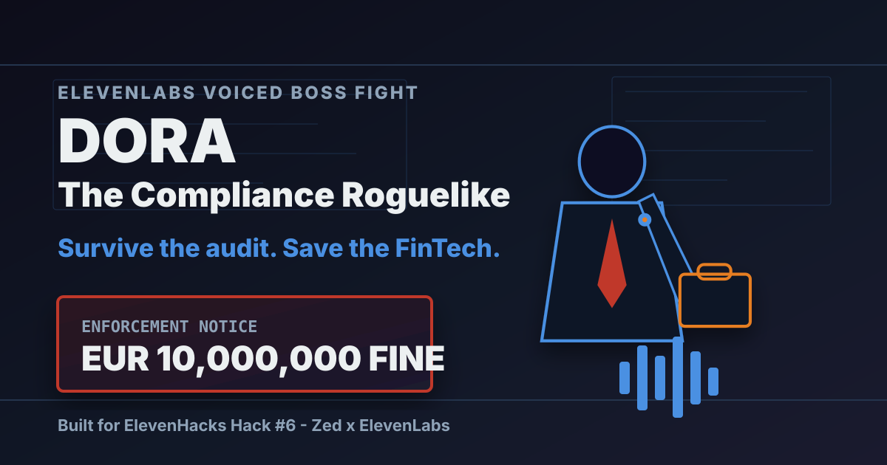

# DORA: The Compliance Roguelike



Survive the audit. Save the FinTech.

A browser-based card roguelike where you play as a FinTech CTO defending against EU regulatory audit findings. The Regulator is designed around pre-generated ElevenLabs TTS, adaptive music, and audit findings that escalate into a Grand Regulator boss phase.

## Live Demo

https://dora-roguelike.vercel.app

## How to Play

You are the CTO. Each round the Regulator raises an audit finding that damages one or more of your five compliance indicators: **ICT risk, incidents, third-party, testing and reporting**. You have **15 seconds** to play a card from your hand (real DORA, NIS2 and GDPR controls such as *DORA Art.9 Patch* or *Third-Party Register*) to defend or repair.

- Survive all **15 rounds**, including the **Grand Regulator** boss phase, to win.
- If any indicator drops to **0**, you lose.
- The Regulator's dialogue, music and sound effects react to how the round is going.

Play it at https://dora-roguelike.vercel.app, or run it locally (below).

## Built With

- Vanilla TypeScript
- Vite
- Canvas API
- ElevenLabs-ready audio manifest
- Zed-assisted feature delivery workflow

## Local Development

```bash
npm install
npm run dev
```

Open the Vite URL and tap once to unlock audio. Use `VITE_DEBUG_SKIP_AUDIO=true` only when you intentionally want to bypass missing local audio files.

## Validation

```bash
npm test
npm run build
```

## QA Shortcuts

- `N`: next round
- `B`: force boss round
- `V`: force victory
- `F`: force defeat
- `Q/W/E/R/T`: damage compliance indicators
- `A`: restore the lowest indicator

For production video capture, append `?recording=1` to the live demo URL to enable the same shortcuts without changing the normal judge-facing URL.

For Dutch regulator mode, append `?locale=nl` to the live demo URL.

For the optional GDPR Data Protection Authority boss, append `?boss=gdpr`.

For Systemic Institution hard mode, append `?difficulty=hard`.

For two-player audit mode, open two windows:

- Player 1 card hand: `?mode=coop&role=cards`
- Player 2 board and regulator intent: `?mode=coop&role=board`

## ElevenLabs Integration

The game uses stable audio ids for:

- Standard Regulator dialogue
- Grand Regulator boss dialogue
- Menu, calm, tense, boss, victory, and defeat music
- Card play, block, damage, critical damage, and boss entrance SFX

During development, `VITE_DEBUG_SKIP_AUDIO=true` lets the game exercise all audio calls without requiring generated files. Production audio is enabled by default when the variable is unset.

To generate audio locally, add `ELEVENLABS_API_KEY` to `.env`, then run:

```bash
npm run generate:audio -- --kind=tts
npm run generate:audio -- --kind=tts-nl
npm run generate:audio -- --kind=tts-gdpr
npm run generate:audio -- --kind=tts-hard
npm run generate:audio -- --kind=sfx
npm run generate:audio -- --kind=music
```

Generated MP3 files are written to `public/audio/` and preloaded before the tap-to-start screen.

## Environment Variables

Copy `.env.example` to `.env`. Only the audio generator uses these (they are not needed to play).

| Variable | Description |
|---|---|
| `ELEVENLABS_API_KEY` | API key used by `npm run generate:audio` |
| `VITE_DEBUG_SKIP_AUDIO` | `true` skips loading audio files (development only) |
| `REGULATOR_VOICE_ID` | ElevenLabs voice for the Regulator |
| `GRAND_REGULATOR_VOICE_ID` | Voice for the boss |
| `LAWYER_VOICE_ID` | Voice for the Legal Counsel card |
| `ELEVENLABS_TTS_MODEL_ID` | TTS model, default `eleven_multilingual_v2` |

## Scripts

| Command | What it does |
|---|---|
| `npm run dev` | Vite dev server with hot reload |
| `npm run build` | Type-check and production build to `dist/` |
| `npm run preview` | Serve the production build |
| `npm test` | Unit tests |
| `npm run generate:audio -- --kind=<kind>` | Generate ElevenLabs audio (`tts`, `tts-nl`, `tts-gdpr`, `tts-hard`, `sfx`, `music`) |

## Project Structure

```
src/
├── main.ts, config.ts       Entry point; constants (rounds, timer, indicators, colours)
├── game/                    Rules: GameState, CardDeck, ComplianceBoard, RegulatorAI, TurnTimer, CoopMode, DebugActions
├── scenes/                  Loading, Menu, Game, Boss, Victory, Defeat
├── ui/                      Canvas renderers: board, cards, HUD, Regulator
└── audio/                   Audio cache, ElevenLabs manifest, adaptive MusicDirector
scripts/generate-audio.mjs   Pre-generates TTS, SFX and music into public/audio/
tests/                       Unit tests for the game rules, audio and renderers
```

## Docker

```bash
docker build -t dora-roguelike .
docker run -p 8080:80 dora-roguelike     # http://localhost:8080
```

The image builds the game with Node and serves the static output with Nginx.

## Continuous Integration

GitHub Actions (`.github/workflows/ci.yml`) runs `npm ci`, `npm test` and `npm run build` on every push and pull request.

## Contributing

New regulatory cards, Regulator lines with real article references, localisations and difficulty modes are welcome. See [CONTRIBUTING.md](CONTRIBUTING.md) and [CHANGELOG.md](CHANGELOG.md).
